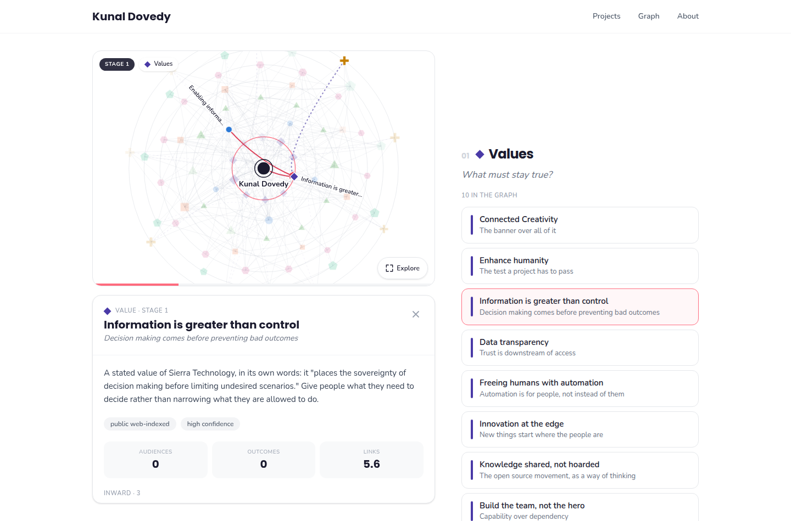
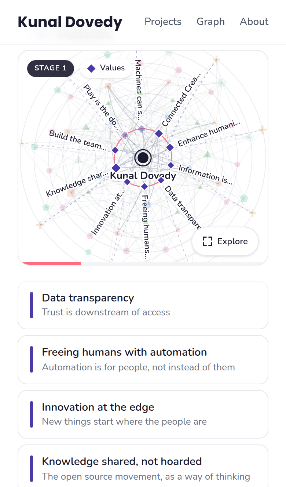
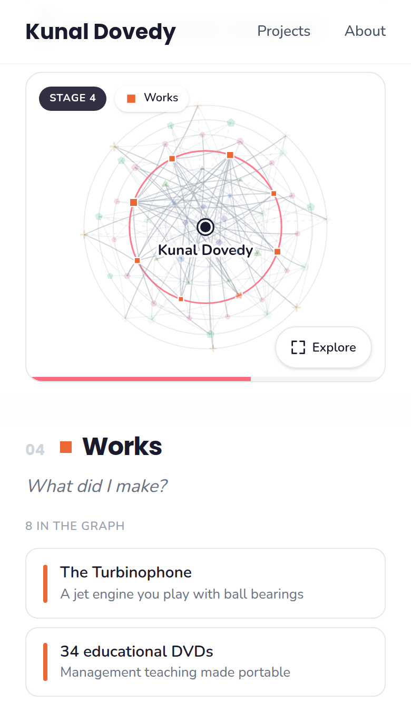

# mygraph

[](https://github.com/kunaldovedy/mygraph/actions/workflows/ci.yml)
[](LICENSE.md)
[](COMMERCIAL.md)

**A graph database and a drawing of how one person serves the world.**

Most portfolios are a list of things you made. A list cannot show you the part
that matters: the path from what you believe, through what you can do, to the
person on the other end who is different afterwards. That is a graph, so this
project stores it as one.

The seed graph in `data/` is Kunal Dovedy's, built only from public sources.
It is live at **[kunaldovedy.com/graph](https://kunaldovedy.com/graph)**. The
machinery underneath is general: change the YAML and it becomes yours.

<p align="center">
  
</p>

```
me → values → practices → capabilities → works → vehicles → audiences → outcomes
 ↑                                                                          │
 └──────────────── outcomes renew the values that started them ─────────────┘
```

---

## Start here

```bash
git clone https://github.com/kunaldovedy/mygraph
cd mygraph
make install     # PyYAML, and pytest for the tests
make build       # validate the data, write the database and the page
make serve       # open http://127.0.0.1:8787/viz/
```

Python 3.10 or newer. PyYAML is the only runtime dependency, and the
visualisation has none at all.

`make build` produces three things in `build/`:

| File | What it is |
|---|---|
| `mygraph.db` | A SQLite property graph. Query it with any SQLite client. |
| `graph.json` | What the visualisation reads. |
| `mygraph.html` | The same page with the data inlined. One file, works offline. |

## The eight stages

Each stage answers one question. A stage with nothing in it is not a tidy
graph, it is a gap in the practice.

| Stage | Kind | The question it answers |
|---|---|---|
| 0 | Person | Who is at the centre? |
| 1 | Values | What must stay true? |
| 2 | Practices | What do I actually do? |
| 3 | Capabilities | What can I do that is hard to buy? |
| 4 | Works | What did I make? |
| 5 | Vehicles | Through what does the work travel? |
| 6 | Audiences | Who is on the other end? |
| 7 | Outcomes | What changed for them? |

Stage 6 is the one most people skip. It is easier to list what you made than
to name who received it, which is exactly why the graph asks.

Outcomes then point back at values, and audiences point back at capabilities.
Those return edges are drawn dashed, bowing through the middle of the diagram.
Without them the picture is a pipeline; with them it is a practice.

## The visualisation

Open `build/mygraph.html`, or run `make serve`.

<p align="center">
  
  &nbsp;&nbsp;
  
</p>

- **Stages** lays the graph out as concentric rings, one per stage, ordered so
  that related things sit near each other. **Free** relaxes it into a spring
  layout that still remembers which ring each node belongs to.
- Every kind of node has its own **shape as well as its own colour**, so the
  diagram still reads if you cannot separate two hues.
- Nodes in the middle rings stay quiet until you hover or select them.
  Naming all sixty at once buries the picture.
- Click a node to see its summary, its provenance, and every statement it makes
  or receives. Arrowheads appear on the connections you light up.
- A node drawn **hollow with a dashed edge** is inferred rather than sourced.
  It is a question, not a fact.
- **Every node, as text** at the bottom of the page carries the same data as a
  sortable table, for anyone the picture does not serve.

## On the website

`integrations/kunaldovedy.com/` holds a mobile-first `/graph` route for the
Next.js site, built and verified against the real repository. Install it with
two commands; see that directory's README.

The phone version does not shrink the diagram, which never works. It changes
the interaction. The drawing is sticky at the top of the screen and the scroll
drives the camera outward through the rings, one stage at a time, while the
stage list scrolls beneath it. Pinch and pan live behind a full-screen
**Explore** button so gestures never fight the page scroll. Tapping a node
opens a real bottom sheet with snap points and velocity-aware drag, and the
connections inside it are rows you tap to walk the graph.

Regenerate its data after editing any YAML:

```bash
make site-data SITE=/path/to/kunaldovedy.com
```

## Let Claude build yours

The repository ships a Claude Code agent skill at
`.claude/skills/service-graph/`. Open the project with Claude and say *build my
service graph*, and it will interview you and write the YAML.

It does not start by asking what you value, because nobody can answer that
cold. It starts at **works**, which everyone can list, walks outward to the
audiences and outcomes most people never name, and only then comes back to
values, once the evidence is on the table. It also knows the provenance rules
below and will refuse to mark something as sourced when it only inferred it.

To use the skill in another project, copy that one directory into your own
`.claude/skills/`.

## Making it yours

Everything lives in `data/`. There is no database to migrate and no admin
screen. Edit the YAML and run `make build`.

```yaml
# data/nodes/40-works.yaml
- id: w-my-thing
  type: work
  label: The thing I made
  subtitle: One line that earns a second look
  summary: >-
    Two or three sentences. What it is, who it was for, what it cost you.
  source: self          # public-web | public-github | public-profile | inferred | self | placeholder
  confidence: high      # high | medium | low
  refs: [https://example.com/the-thing]
  props: { years: 2024 }
```

```yaml
# data/edges/30-work-to-vehicle.yaml
- { src: w-my-thing, rel: carried_by, dst: o-some-venue, weight: 1.6,
    source: self, confidence: high }
```

`make check` refuses anything that does not hold together: an edge to a node
that is not there, a relation between the wrong kinds of thing, a duplicate id,
or a node with no edges at all. The rules live in `schema/ontology.yaml`, which
is also where you add a new kind of node or a new relation.

### Keeping private things private

`data/private/` is git-ignored and read automatically when it exists. Put client
names, unlaunched work or anything else you would rather not publish in
`data/private/nodes/*.yaml` and `data/private/edges/*.yaml`. They appear in your
local graph and never in a commit.

```bash
mkdir -p data/private/nodes data/private/edges
```

### Provenance is required, not optional

Every node and edge declares a `source` and a `confidence`. The seed graph is
honest about the difference between what is published and what was read between
the lines: eleven nodes are marked `inferred`, the page counts them under
**Still to confirm**, and it draws them hollow. A service graph that cannot tell
you which parts are guesses is a brochure.

## Asking it questions

```bash
python3 -m mygraph stats                       # counts, provenance, leaders, gaps
python3 -m mygraph node w-turbinophone         # one node and every statement about it
python3 -m mygraph find "museum"               # search labels and summaries
python3 -m mygraph path me a-museum-visitors   # how the service actually arrives
python3 -m mygraph reach --type outcome        # everything the centre eventually produces
python3 -m mygraph top betweenness             # what the practice depends on
```

```
$ python3 -m mygraph path me a-museum-visitors
Kunal Dovedy
  practices -> Creating interactive art and music
  serves -> Museum visitors and families
```

Or open the database directly. Traversal is a recursive common table
expression, and the `statement` view reads the graph back as sentences:

```sql
SELECT subject, verb, object FROM statement WHERE rel = 'produces';
```

## Taking it somewhere else

```bash
make exports
```

| Command | Gives you |
|---|---|
| `mygraph export cypher` | A script that rebuilds the graph in Neo4j or Memgraph |
| `mygraph export graphml` | Gephi, yEd, Cytoscape |
| `mygraph export mermaid` | A diagram you can paste into a README |
| `mygraph export json` | The raw data |
| `mygraph export web` | The same data trimmed for a phone, about half the size |
| `mygraph export html` | The single-file page |

## How it is put together

```
schema/ontology.yaml   node kinds, relation rules, provenance vocabulary
schema/palette.yaml    one source of truth for colour
data/nodes/*.yaml      the nodes, one file per stage
data/edges/*.yaml      the edges, one file per movement
src/mygraph/model.py   load and validate
src/mygraph/db.py      the SQLite schema and the views
src/mygraph/metrics.py degree, PageRank, betweenness, reach
src/mygraph/export.py  every output format
src/mygraph/cli.py     the command line
viz/index.html         the page, with no build step and no dependencies
tests/test_graph.py    36 tests, including rules about the graph itself
docs/design.md         why it looks the way it does
integrations/          the /graph route for kunaldovedy.com
.claude/skills/        the agent skill, for building a graph with Claude
```

No framework, no bundler, no server. Python's standard library plus PyYAML on
one side; plain SVG and about six hundred lines of JavaScript on the other.

## Tests

```bash
make test
```

Some of the tests check the code. Others check the graph: that the loop closes,
that every outcome reaches somebody, that every node says where it came from.
Those will fail if the practice stops making sense, which is the point. One
checks that the copy of the data shipped to the website is still in step with
the YAML.

## Sources for the seed graph

Built from public material only: [kunaldovedy.com](https://www.kunaldovedy.com/),
[turbinophone.com](http://www.turbinophone.com/), the
[Turbinophone Kickstarter](https://www.kickstarter.com/projects/kdovedy/the-turbinophone-burning-man-2013),
a public [LinkedIn profile](https://www.linkedin.com/in/kdovedy/), an
[IMDb page](https://www.imdb.com/name/nm3366460/), an
[org listing](https://theorg.com/org/ralliant/org-chart/kunal-dovedy) and public
GitHub repositories. Private repositories and client specifics are deliberately
left out.

## Licence

**Free for individuals and small companies. Larger companies need a paid
licence. Every use keeps the attribution.**

| You are | What applies |
|---|---|
| A person mapping your own practice | Free. Keep the notice. |
| A hobbyist, student or researcher | Free. Keep the notice. |
| A freelancer or consultant under the thresholds below | Free, including on paid client work. Keep the notice. |
| A company under 100 people **and** under 1M USD revenue | Free. Keep the notice. |
| A company over either threshold | [Paid licence](COMMERCIAL.md). Email hello@kunaldovedy.com. |

The terms are the
[PolyForm Small Business License 1.0.0](LICENSE.md), unmodified. The revenue
figure is indexed to United States inflation from 2019, so it rises over
time.

This is source-available rather than open source. Nearly everyone who will
ever touch it can use it for nothing. The ones who pay are the ones for whom
it is already paying.

Attribution binds through the licence's Notices section and the
`Required Notice:` line in [NOTICE](NOTICE). It has to travel with any copy
you pass on, and Kunal Dovedy should be credited visibly wherever you publish
something built with this.

[COMMERCIAL.md](COMMERCIAL.md) sets out the thresholds and how to buy a
licence.

### The example data is separate

The files under `data/` describe a real person and are **not** licensed for
reuse. See [data/README.md](data/README.md). You need none of it to use the
tool. Replace it with your own.
